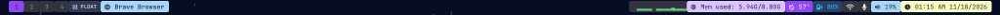

# sketchybar_config

Personal SketchyBar configuration for macOS.



This setup provides a clean, minimal status bar with dynamic updates, Google Calendar integration, and custom system indicators.

## Features

- **Dynamic Spaces**: Yabai integration with active space highlighting and icon badges.
- **Yabai Layout Mode**: Live indicator for `[BSP]` (automatic tiling) vs `[FLOAT]` mode with click-to-toggle support.
- **Front Application**: Real-time focused app display in an accent pill.
- **RAM Usage & Live Meter**: Memory used vs total formatted text pill plus real-time visual sparkline/meter graph.
- **Weather & Temperature**: Auto-location, minimal Nerd Font weather condition icons, day/night awareness.
- **Microphone**: MicMute integration displaying live hardware and software mute status.
- **Bluetooth & Wi-Fi**: Dedicated status pills with connection detection.
- **Battery**: Custom battery percentage and dynamic charging/discharging state icons.
- **Volume**: Output volume indicator synced to system audio changes.
- **Focus Mode**: Focus mode status (auto-hides when no Focus is active).
- **Clock**: Formatted time and date pill.
- **Google Calendar (Optional)**: Next upcoming event display with hover popup details.
- **Aesthetic**: Minimalist transparent bar with blur and colorful rounded pills.

## Folder Structure

```text
sketchybar_config/
├── assets/
│   └── preview.png
├── sketchybarrc
├── plugins/
│   ├── battery_custom.sh
│   ├── bluetooth_custom.sh
│   ├── clock_custom.sh
│   ├── focus_custom.sh
│   ├── front_app.sh
│   ├── google_calendar.py
│   ├── google_calendar.sh
│   ├── mic_custom.sh
│   ├── ram_custom.sh
│   ├── space.sh
│   ├── volume_custom.sh
│   ├── weather_custom.sh
│   ├── wifi_custom.sh
│   └── yabai_mode.sh
```

**Note:**  
The `google/` folder containing API credentials is intentionally excluded from this repository.

## Requirements

Install dependencies using Homebrew:

brew install sketchybar
brew install yabai
brew install jq

Recommended font:
JetBrainsMono Nerd Font

## Installation

1. Copy this repository into:

```bash
~/.config/sketchybar/
```

2. Make plugin scripts executable:

```bash
chmod +x ~/.config/sketchybar/plugins/*
```

3. Reload SketchyBar:

```bash
sketchybar --reload
```

## Google Calendar Setup (Optional)

This configuration supports Google Calendar API integration.

### Steps

1. Create a Google Cloud project.
2. Enable the Google Calendar API.
3. Generate OAuth credentials.
4. Place credentials inside:

```bash
~/.config/sketchybar/google/
```

## Reloading

After editing configuration files:

```bash
sketchybar --reload
```

If issues occur:

```bash
brew services restart sketchybar
```

The Focus indicator reads macOS's Focus assertion database and uses Apple's
`moon.fill` glyph. It disappears when no Focus mode is active. SketchyBar
needs Full Disk Access to read the protected database; grant it to the
SketchyBar executable in System Settings > Privacy & Security, then reload
SketchyBar.

## Notes

- The main bar shows the next upcoming timed event.
- Hovering over the calendar item toggles a popup.
- Styling is transparent with blur.
- Designed for macOS with Yabai tiling window manager.
